<div align="center">


# Mochi

**A tiny liquid-glass companion that lives in a dynamic island at the top of your Windows desktop.**

It watches your cursor, reacts to what your PC is doing, changes colour with its mood,<br>
and turns the top of your screen into a little hub for music, files, timers and notifications.

[](https://github.com/JesseVerboven/mochi/releases/latest)
[](LICENSE)


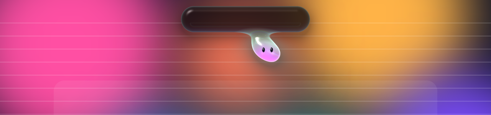

</div>

---

## Meet Mochi

Mochi is a droplet of tinted jelly hanging from a glassy, Dynamic Island–style pill. Everything is drawn in one WebGL shader, so the glass **bends whatever is behind it**, with rim light, specular highlights and a hint of chromatic dispersion. Mochi itself is built to feel alive through motion: spring physics, squash and stretch, breathing, blinking, and eyes that follow you around.

| | |
|---|---|
| **Moves toward you.** Bring your cursor close and Mochi leans out and stretches toward it. Whip past and it jumps back, startled. Hover slowly to pet it (hearts!). Click it for a squish, or grab it and drag it out on a gooey strand. |  |
| **Has moods.** Calm, curious, happy, in love, excited, sleepy, alert, sad. Each has its own colours, energy and eyes. While music plays, Mochi takes its colours **from the album cover** and grooves to the beat. | 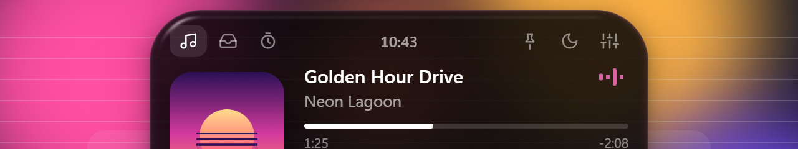 |
| **Takes naps.** After a few idle minutes (or when you lock your PC) the island shrinks, Mochi tucks in and z's drift out. It wakes up happy when you're back. | 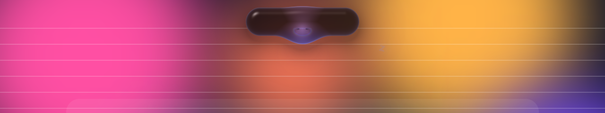 |

## The island

Hover the island (or click to keep it open) and it springs open into a hub with tabs.

### 🎵 Now playing
Track, artist and album art from Spotify (or **any** media app, if you like), plus a live, seekable progress bar and previous / play-pause / next. While something plays, the resting island becomes a mini live activity with cover art and an equaliser.

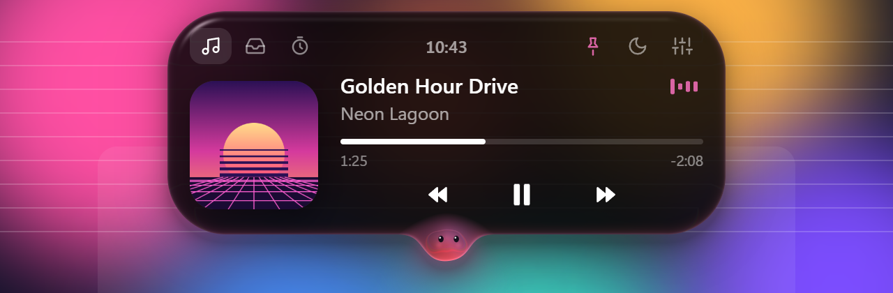

### 📥 File shelf
Drag files or folders onto the island to park them there. Later, **drag them back out into any app**: Explorer, email, chat, an editor. Double-click opens a file, right-click shows it in its folder. Files stay where they are and the shelf survives restarts.

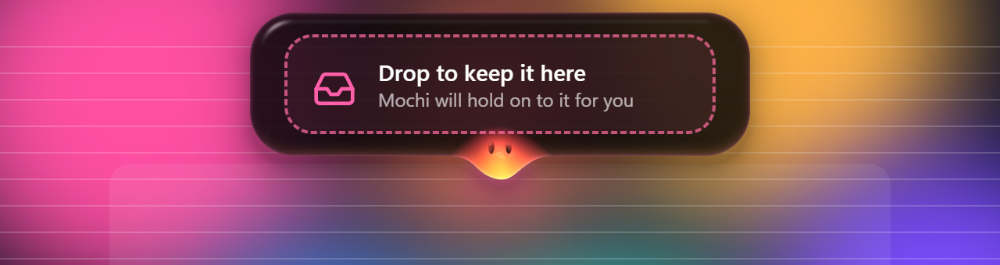
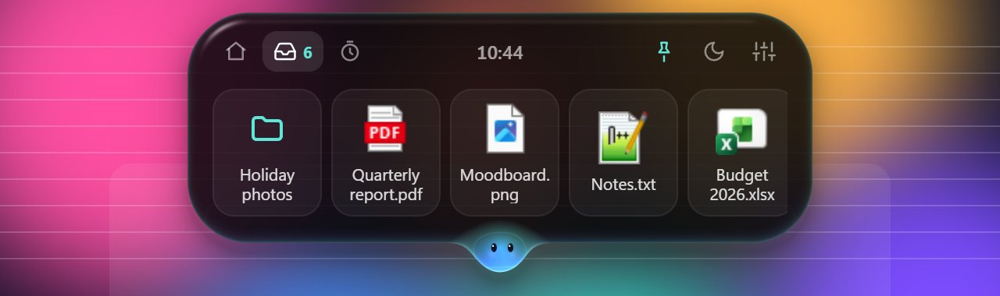

### ⏱️ Timer
One click for 1–45 minutes. The countdown lives in the resting island; add a minute, pause or stop it from the hub. When it's done: a chime and a happy dance. It even gets through Do Not Disturb.

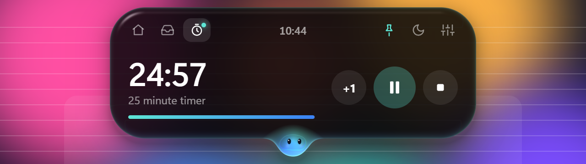
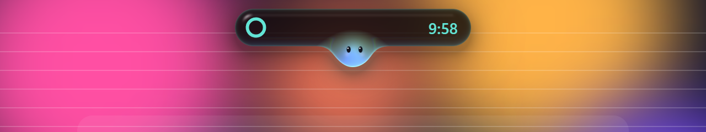

### 🕐 Clock & system stats
Six clock styles (classic, light, bold, mono, neon, stacked), three sizes, 12/24h, seconds, date formats, and optional battery / CPU / RAM rings.

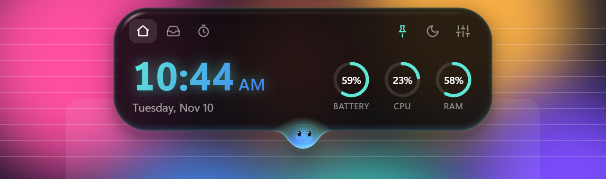

### 🔔 Notifications
Charging, battery low, CPU working hard, offline/online, lock/unlock, copied text (things that look like passwords are hidden), an hourly stretch reminder, and **your own notifications** from any script (see the [notify API](#-notify-api)).

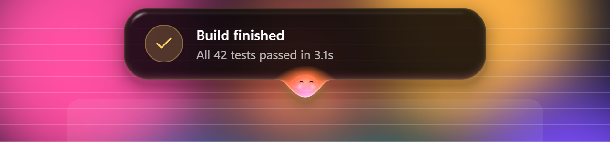

## Make it yours

Everything is adjustable in the settings window, and changes apply instantly.

<table>
<tr>
<td width="52%">

- **Companion:** rename it, choose a colour theme, pick when it dozes off
- **Black & white:** everything in greyscale
- **Minimal mode:** hide Mochi and keep a clean, solid black island
- **Clock:** style, size, format, seconds, date, time in the resting island
- **System stats:** on/off, per stat
- **Features:** media player, file shelf, timer
- **Notifications:** Do Not Disturb, categories, duration, sounds
- **Look:** liquid glass or solid black island, refraction, start with Windows

</td>
<td>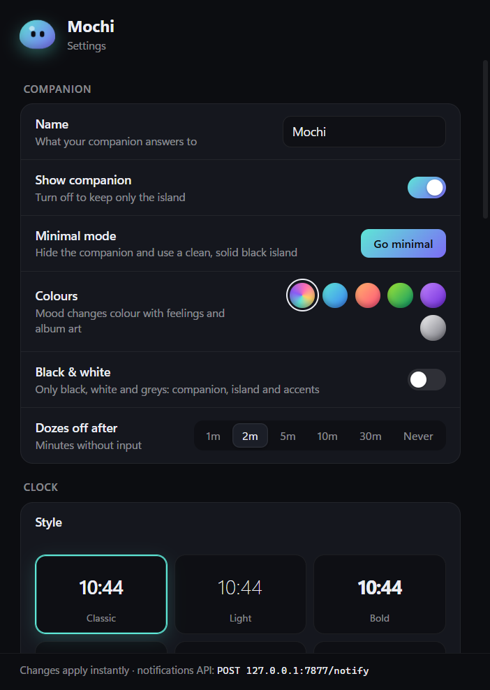</td>
</tr>
</table>

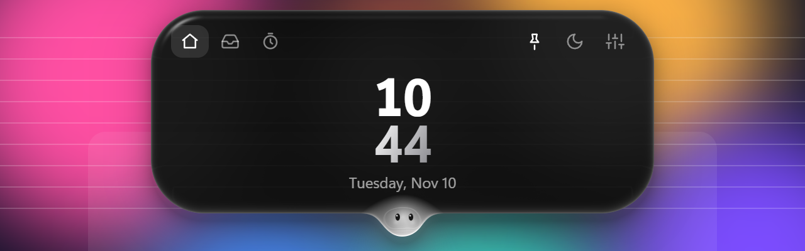
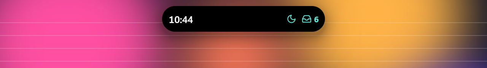

## Install

1. Download **`Mochi-Setup-x.y.z.exe`** from the [latest release](https://github.com/JesseVerboven/mochi/releases/latest).
2. Run it. Mochi appears at the top of your screen and in the system tray.

> **Windows SmartScreen** may warn that the app is from an unknown publisher because the installer isn't code-signed. Click **More info → Run anyway**.

Open settings from the tray icon (right-click → *Settings…*, or double-click), or with the sliders button in the hub.

## 🔌 Notify API

Mochi listens on `127.0.0.1:7877` (localhost only) so your scripts, builds and tools can show notifications in the island:

```bash
curl -X POST -H "Content-Type: application/json" \
  -d '{"title":"Build finished","body":"All tests passed","mood":"happy","icon":"check"}' \
  http://127.0.0.1:7877/notify
```

```powershell
Invoke-RestMethod -Method Post -Uri http://127.0.0.1:7877/notify -ContentType application/json `
  -Body '{"title":"Render done","mood":"excited"}'
```

| Field | Values |
|---|---|
| `title`, `body` | text (up to 160 chars) |
| `mood` | `calm` `curious` `happy` `love` `excited` `sleepy` `alert` `sad` |
| `icon` | `bell` `check` `warn` `clip` `bolt` `battery` `wifi` `wifi-off` `cpu` `clock` `moon` `heart` `sparkle` `tray` |
| `duration` | milliseconds, 1500–15000 (defaults to your setting) |

The endpoint only accepts `application/json` and a `127.0.0.1`/`localhost` Host header, so web pages can't post to it.

## Build from source

Requires [Node.js](https://nodejs.org) 20+ on Windows.

```bash
git clone https://github.com/JesseVerboven/mochi.git
cd mochi
npm install
npm start            # run it
npm run dist         # build the installer into dist/
```

Other scripts: `npm run start:debug` (logging and a `/debug` route for driving views), `npm run icon` (regenerate the app icon), `npm run screenshots` (re-render the images in this README offscreen).

## How it works

| Piece | What it does |
|---|---|
| [`main.js`](main.js) | Transparent, click-through, always-on-top window; cursor polling; system events; validated settings; file shelf with native drag-out; tray; notify endpoint |
| [`renderer/shader.js`](renderer/shader.js) | One fragment shader: island and Mochi as signed distance fields joined by a smooth-min (the droplet neck), turned into a height field for refraction, dispersion, fresnel, specular and the face |
| [`renderer/app.js`](renderer/app.js) | Spring physics, moods, the island state machine, hub, media, shelf, timer and clock |
| [`settings/`](settings) | The settings window |
| [`helpers/media.ps1`](helpers/media.ps1) | Talks to Windows' system media sessions (the same source as the volume flyout) for now-playing info and controls |

A few details worth knowing:

- **Refraction** samples a live capture of your desktop. The window excludes itself from capture (`WDA_EXCLUDEFROMCAPTURE`) so it sees what's *behind* it, which also means **Mochi doesn't appear in your screenshots or screen shares**.
- **Clipboard** reactions run in a small helper process that checks the clipboard sequence number and reads text with a timeout, so an app that stops responding can never freeze Mochi.
- **Privacy:** Mochi makes no network requests. Settings and the shelf (file paths only) are stored in `%APPDATA%\Mochi`.

## License

[MIT](LICENSE) © 2026 Jesse Verboven
